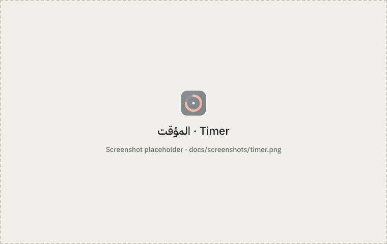
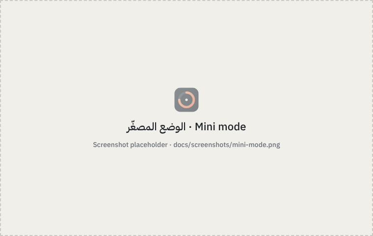
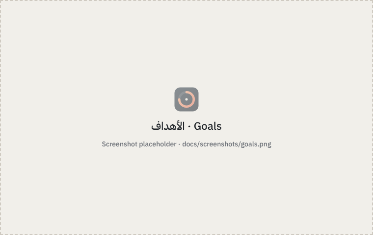
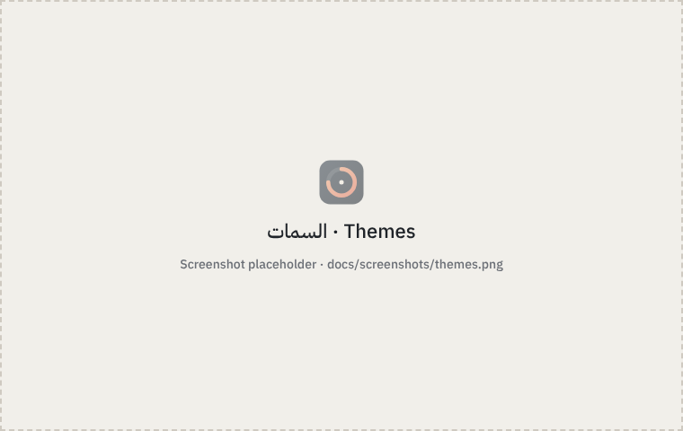

<div align="center">


# أوان · Awan

مؤقّت بومودورو أنيق وبسيط لويندوز
<br />
A minimal, elegant Pomodoro timer for Windows

[العربية](#العربية) · [English](#english)

</div>

---

<div dir="rtl">

## العربية

**أوان** مؤقّت بومودورو لسطح المكتب يعمل دون اتصال بالإنترنت: جلسات تركيز واستراحات، وإحصاءات وأهداف أسبوعية، ووضع مصغّر يبقى فوق النوافذ، بواجهة هادئة تدعم العربية والإنجليزية.

### لقطات الشاشة

| المؤقت | الوضع المصغّر |
| --- | --- |
|  |  |
| **السجل** | **الأهداف** |
|  |  |



### المزايا

- **المؤقت:** تركيز واستراحة قصيرة وطويلة (افتراضيًا ٢٥ و٥ و١٥ دقيقة، والطويلة بعد كل ٤ جلسات)، وبدء تلقائي اختياري، وإشعار وصوت عند انتهاء كل جلسة.
- **دقيق:** يُحسب الوقت من ساعة النظام، فيبقى دقيقًا والنافذة مصغّرة. وإذا دخل الجهاز في السكون يتوقف المؤقت ولا يُحتسب وقت السكون.
- **لا يضيع شيء:** إذا أُغلق التطبيق أثناء جلسة يسألك عند الفتح التالي: استئناف أم بدء من جديد.
- **الوضع المصغّر:** نافذة صغيرة فيها الوقت فقط، فوق كل النوافذ، بشفافية قابلة للضبط.
- **علبة النظام:** الوقت المتبقي عند الوقوف على الأيقونة، وقائمة للتحكم السريع.
- **الاختصارات:** Space للبدء والإيقاف، وR للإعادة، وS للتخطي، وM للوضع المصغّر، واختصار عام يعمل والتطبيق في الخلفية.
- **السجل والإحصاءات:** كل جلسة محفوظة، وإجمالي اليوم والأسبوع والشهر، ورسم لآخر ٧ أيام، وتصدير CSV.
- **الأهداف:** هدف أسبوعي بالساعات وهدف يومي اختياري، مع إشعار عند تحقيقهما.
- **السمات:** ست سمات جاهزة، وسمة تتبع وضع ويندوز، وسمة مخصّصة بألوانك.
- **بياناتك على جهازك:** تُحفظ في مجلد AppData، ولا تُحذف عند التحديث أو إعادة التثبيت، ويمكن نسخها احتياطيًا في ملف واحد.

### التنزيل والتثبيت

1. افتح صفحة **[الإصدارات (Releases)](../../releases/latest)** ونزّل ملف `Awan_..._x64-setup.exe`.
2. شغّل الملف واتبع الخطوات القصيرة. لا يحتاج صلاحيات المدير.
3. قد يظهر تحذير «Windows protected your PC» لأن المثبّت غير موقَّع رقميًا: اضغط **More info** ثم **Run anyway**.

يعمل على ويندوز 10 و11. ويُنزَّل WebView2 تلقائيًا إن لم يكن موجودًا (مثبّت مسبقًا في ويندوز 11 ومعظم أجهزة ويندوز 10).

**إلغاء التثبيت:** من «الإعدادات ← التطبيقات ← التطبيقات المثبّتة». تبقى بياناتك محفوظة ما لم تختر حذفها.

### البناء من المصدر

المتطلبات: [Node.js 22](https://nodejs.org) و[Rust](https://rustup.rs) و[متطلبات Tauri لويندوز](https://tauri.app/start/prerequisites/).

```bash
npm ci             # تنصيب أداة Tauri
npm run dev        # تشغيل التطبيق للتطوير
npm test           # اختبارات الواجهة
cd src-tauri && cargo test   # اختبارات المنطق
npm run build      # بناء المثبّت في src-tauri/target/release/bundle/nsis
```

### إضافة سمة جديدة

كل السمات في ملف واحد: `src/styles/themes.css`. انسخ إحدى الكتل، وغيّر اسمها (`data-theme`) وألوانها، وستظهر في الإعدادات تلقائيًا.

### نشر إصدار جديد

```bash
npm run version -- 1.1.0   # يحدّث رقم الإصدار في كل الملفات
git commit -am "Release 1.1.0"
git tag v1.1.0 && git push && git push origin v1.1.0
```

عند رفع الوسم يبني GitHub Actions المثبّت ويرفعه إلى صفحة الإصدارات تلقائيًا.

### الترخيص

[MIT](LICENSE). الخط المضمَّن IBM Plex Sans Arabic مرخّص بـ [SIL OFL 1.1](src/assets/fonts/OFL.txt).

</div>

---

## English

**Awan** (Arabic for "the right moment") is a fully offline Pomodoro timer for the Windows desktop: focus sessions and breaks, statistics and weekly goals, and an always-on-top mini timer, in a calm interface available in Arabic and English.

### Screenshots

| Timer | Mini mode |
| --- | --- |
|  |  |
| **History** | **Goals** |
|  |  |


### Features

- **Timer:** focus, short break and long break (25 / 5 / 15 minutes by default, a long break after every 4 sessions), optional auto-start, and a notification and sound when each session ends.
- **Accurate:** time comes from the system clock, so it stays exact while minimized. If the computer sleeps, the timer pauses and sleep time isn't counted.
- **Nothing lost:** if the app is closed mid-session, it asks on the next launch whether to resume or start fresh.
- **Mini mode:** a small always-on-top window with just the time, with adjustable opacity.
- **System tray:** remaining time on hover and a menu for quick control.
- **Shortcuts:** Space start/pause, R reset, S skip, M mini mode, plus a global shortcut that works in the background.
- **History and statistics:** every session is saved; totals for today, this week and this month; a 7-day chart; CSV export.
- **Goals:** a weekly goal in hours and an optional daily goal, with a notification when reached.
- **Themes:** six built-in themes, an "auto" theme that follows Windows, and a custom theme from your own colors.
- **Your data stays on your PC:** stored in AppData, kept across updates and reinstalls, and exportable to a single backup file.

### Download and install

1. Open the **[Releases](../../releases/latest)** page and download `Awan_..._x64-setup.exe`.
2. Run it and follow the short installer. No administrator rights needed.
3. Windows may warn "Windows protected your PC" because the installer is not code-signed: click **More info**, then **Run anyway**.

Works on Windows 10 and 11. WebView2 is downloaded automatically if it is missing (it ships with Windows 11 and most Windows 10 PCs).

**Uninstall:** Settings → Apps → Installed apps. Your data is kept unless you choose to delete it.

### Build from source

Requirements: [Node.js 22](https://nodejs.org), [Rust](https://rustup.rs) and the [Tauri prerequisites for Windows](https://tauri.app/start/prerequisites/).

```bash
npm ci             # install the Tauri CLI
npm run dev        # run the app in development
npm test           # UI unit tests
cd src-tauri && cargo test   # core logic tests
npm run build      # build the installer into src-tauri/target/release/bundle/nsis
```

### Add a theme

All themes live in one file, `src/styles/themes.css`. Copy a block, give it a new `data-theme` name and colors, and it appears in Settings automatically.

### Publish a new version

```bash
npm run version -- 1.1.0   # update the version everywhere
git commit -am "Release 1.1.0"
git tag v1.1.0 && git push && git push origin v1.1.0
```

Pushing the tag makes GitHub Actions build the installer and attach it to the release.

### Project layout

```
src/                 UI: HTML, CSS and JavaScript (no framework, no bundler)
  styles/themes.css  all themes
  js/pages/          timer, history, goals, settings
  locales/           Arabic and English text
src-tauri/           native side (Rust): timer engine, SQLite storage,
                     tray, mini window, shortcuts, notifications
scripts/             icon, sound generator, version bump, Windows smoke test
tests/               JavaScript unit tests
```

### License

[MIT](LICENSE). The bundled IBM Plex Sans Arabic font is licensed under the [SIL OFL 1.1](src/assets/fonts/OFL.txt).
