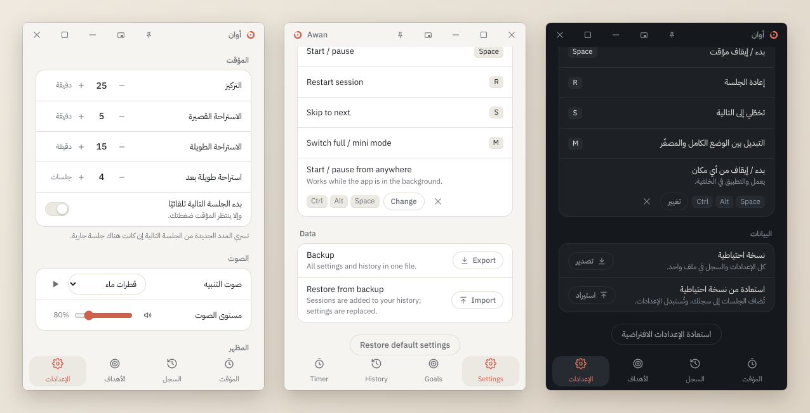

# أوان · Awan

مؤقّت بومودورو هادئ وبسيط لويندوز
 
A calm, minimal Pomodoro timer for Windows

**[تنزيل أحدث إصدار · Download the latest release](../../releases/latest)**

[العربية](#العربية) · [English](#english)

---

## العربية

**أوان** مؤقّت بومودورو لسطح مكتب ويندوز يعمل بالكامل دون اتصال بالإنترنت. يقسّم وقتك إلى جلسات تركيز تتخلّلها استراحات، ويحفظ سجلّ جلساتك ويتابع أهدافك، بواجهة هادئة باللغتين العربية والإنجليزية.

### لقطات الشاشة

| المؤقت | الوضع المصغّر |
| --- | --- |
|  |  |
| **السجل** | **الأهداف** |
|  |  |
| **الإعدادات** | **السمات** |
|  |  |

### المزايا

- **المؤقت:** جلسات تركيز واستراحات قصيرة وطويلة (25 و5 و15 دقيقة افتراضيًا، والاستراحة الطويلة بعد كل 4 جلسات)، مع خيار لبدء الجلسة التالية تلقائيًا.
- **التنبيه:** إشعار من ويندوز وصوت عند انتهاء كل جلسة. الأصوات طبيعية هادئة بلا موسيقى: قطرات ماء، وطرقات على الباب، وعصافير، وحصاة، وموج البحر.
- **الدقة:** يُحسب الوقت من ساعة النظام، فيبقى دقيقًا والنافذة مصغّرة أو مخفية. وإذا دخل الجهاز في وضع السكون توقّف المؤقت ولا يُحتسب وقت السكون.
- **حفظ الجلسة:** إذا أُغلق التطبيق أثناء جلسة، يسألك عند فتحه التالي: هل تستأنفها أم تبدأ من جديد.
- **الوضع المصغّر:** نافذة صغيرة تعرض الوقت فقط وتبقى فوق جميع النوافذ، بشفافية قابلة للضبط.
- **علبة النظام:** يستمر المؤقت عند إغلاق النافذة، وتظهر المدة المتبقية عند الوقوف على أيقونته بجوار الساعة، مع قائمة للتحكم السريع.
- **اختصارات لوحة المفاتيح:** ‏Space للبدء والإيقاف المؤقت، وR لإعادة الجلسة، وS للتخطي، وM للوضع المصغّر، إضافة إلى اختصار عام (Ctrl+Alt+Space افتراضيًا) يعمل والتطبيق في الخلفية.
- **السجل والإحصاءات:** تُحفظ كل جلسة، مع إجمالي وقت التركيز لليوم والأسبوع والشهر، ورسم بياني لآخر 7 أيام، وتصدير السجل بصيغة CSV.
- **الأهداف:** هدف أسبوعي بالساعات وهدف يومي اختياري، مع إشعار عند تحقيق كلٍّ منهما.
- **السمات:** ست سمات جاهزة (فاتح، وداكن، وأسود تام، وأزرق ليلي، وأخضر زيتوني، وبيج دافئ)، وسمة تلقائية تتبع وضع ويندوز، وسمة مخصّصة بألوانك.
- **اللغة:** العربية والإنجليزية، ويتبع التطبيق لغة النظام افتراضيًا.
- **التشغيل مع ويندوز:** خيار لتشغيل التطبيق في علبة النظام عند بدء تشغيل الجهاز.
- **النسخ الاحتياطي:** تصدير الإعدادات والسجلّ في ملف واحد واستعادتهما لاحقًا.

### قادم قريبًا

ميزتان مخطط لهما في الإصدار القادم:

**الخطوط**

- اختيار خط لأرقام المؤقت وخط للواجهة، كلٌّ على حدة.
- خطوط عربية مضمَّنة تعمل دون إنترنت، وكلها بترخيص حر.
- استخدام أي خط مثبّت على ويندوز، أو إضافة ملف خط (TTF أو OTF) بنفسك.
- أرقام المؤقت بعرض ثابت مهما كان الخط، فلا يهتز الوقت أثناء العدّ.
- معاينة فورية قبل الاعتماد، وعودة تلقائية إلى الخط الافتراضي إن لم يدعم الخط الحروف العربية.

**المواظبة (Streak)**

- عدد الأيام المتتالية التي حققت فيها هدفك اليومي، أو أكملت فيها جلسة تركيز واحدة على الأقل إن لم تحدد هدفًا يوميًا.
- أيام راحة تختارها، مثل الجمعة، لا تقطع مواظبتك.
- مواظبة أسبوعية لمن يفضّل إيقاعًا أهدأ: الأسابيع المتتالية التي حققت فيها هدفك الأسبوعي.
- أطول مواظبة لك، وإشعار هادئ حين تتجاوزها.
- خريطة لأيام الأشهر الأخيرة في صفحة الأهداف، يشتدّ لون كل يوم بقدر تركيزك فيه.
- تُحسب من سجلّك الحالي، فتظهر مواظبتك من أول يوم بعد التحديث.
- بلا ضغط: لا رسائل لوم ولا تنبيهات حين تنقطع.

### التنزيل والتثبيت

1. افتح صفحة **[أحدث إصدار](../../releases/latest)** ونزّل الملف `Awan_…_x64-setup.exe` من قسم **Assets**.
2. شغّل الملف واتبع خطوات المثبّت. لا يحتاج التثبيت صلاحيات المسؤول.
3. قد تظهر رسالة «Windows protected your PC» لأن المثبّت غير موقّع رقميًا. اختر **More info** (مزيد من المعلومات) ثم **Run anyway** (تشغيل على أي حال).

**المتطلبات:** ويندوز 10 أو 11 بنظام 64 بت. يعتمد التطبيق على مكوّن Microsoft WebView2 المثبّت مسبقًا في ويندوز 11 ومعظم أجهزة ويندوز 10، وإن لم يكن موجودًا نزّله المثبّت تلقائيًا، وهذه الحالة وحدها تحتاج اتصالًا بالإنترنت أثناء التثبيت.

**التحديث:** نزّل الإصدار الجديد وثبّته فوق الحالي، وتبقى إعداداتك وسجلّك كما هي.

**إلغاء التثبيت:** من «الإعدادات ← التطبيقات ← التطبيقات المثبّتة» في ويندوز. تبقى بياناتك محفوظة ما لم تختر حذفها أثناء إلغاء التثبيت.

### الخصوصية

لا يتصل أوان بالإنترنت ولا يجمع أي بيانات. تُحفظ إعداداتك وسجلّ جلساتك على جهازك فقط، في المجلد `%APPDATA%\io.github.cylinder303.awan`.

### المساهمة

لاقتراح ميزة أو الإبلاغ عن مشكلة افتح [Issue](../../issues). ولبناء التطبيق من المصدر والمشاركة في تطويره راجع [دليل المساهمة](CONTRIBUTING.md).

### الترخيص

أوان مفتوح المصدر بترخيص [MIT](LICENSE). أما الخط المضمَّن فيه، IBM Plex Sans Arabic، فله ترخيصه الخاص: [SIL Open Font License 1.1](src/assets/fonts/OFL.txt).

---

## English

**Awan** (Arabic for "the right time") is a Pomodoro timer for the Windows desktop that works fully offline. It splits your time into focus sessions with breaks in between, keeps a history of your sessions and tracks your goals, in a calm interface available in Arabic and English.

### Screenshots

| Timer | Mini mode |
| --- | --- |
|  |  |
| **History** | **Goals** |
|  |  |
| **Settings** | **Themes** |
|  |  |

### Features

- **Timer:** focus sessions, short breaks and long breaks (25, 5 and 15 minutes by default, with a long break after every 4 sessions), and an option to start the next session automatically.
- **Alerts:** a Windows notification and a sound when each session ends. The sounds are calm and natural, with no music: water drops, a door knock, birds, a pebble and sea waves.
- **Accurate:** time comes from the system clock, so it stays exact while the window is minimized or hidden. If the computer goes to sleep, the timer pauses and sleep time is not counted.
- **Session recovery:** if the app is closed during a session, it asks the next time it opens whether to resume or start over.
- **Mini mode:** a small window that shows only the time and stays on top of all windows, with adjustable transparency.
- **System tray:** the timer keeps running when you close the window. Hover over its icon next to the clock to see the time left, or right-click it for quick controls.
- **Keyboard shortcuts:** Space to start or pause, R to restart the session, S to skip, M for mini mode, plus a global shortcut (Ctrl+Alt+Space by default) that works while the app is in the background.
- **History and statistics:** every session is saved, with total focus time for today, this week and this month, a chart of the last 7 days, and CSV export.
- **Goals:** a weekly goal in hours and an optional daily goal, with a notification when you reach each one.
- **Themes:** six built-in themes (Light, Dark, True black, Midnight blue, Olive green and Warm beige), an automatic theme that follows Windows, and a custom theme in your own colors.
- **Languages:** Arabic and English; the app follows the system language by default.
- **Start with Windows:** an option to start the app in the system tray when you sign in.
- **Backup:** export your settings and history to a single file and restore them later.

### Coming next

Two features planned for the next release:

**Fonts**

- Pick one font for the timer digits and another for the interface.
- Bundled Arabic fonts that work offline, all under free licenses.
- Use any font installed on Windows, or add your own font file (TTF or OTF).
- Timer digits always keep a fixed width, so the time never jitters while counting.
- Live preview before applying, and an automatic fallback to the default font if a font lacks Arabic letters.

**Streak**

- The number of days in a row you reached your daily goal, or finished at least one focus session if you have no daily goal.
- Rest days of your choice, such as Friday, that don't break the streak.
- A weekly streak for a calmer pace: weeks in a row you reached your weekly goal.
- Your longest streak, with a quiet notification when you beat it.
- A map of recent months on the Goals page, each day shaded by how much you focused.
- Built from your existing history, so your streak shows from the first day after the update.
- No pressure: no guilt messages and no alerts when a streak ends.

### Download and install

1. Open the **[latest release](../../releases/latest)** and download `Awan_…_x64-setup.exe` from **Assets**.
2. Run it and follow the installer. No administrator rights are needed.
3. Windows may show "Windows protected your PC" because the installer is not code-signed. Click **More info**, then **Run anyway**.

**Requirements:** 64-bit Windows 10 or 11. The app uses Microsoft WebView2, which ships with Windows 11 and most Windows 10 PCs. If it is missing, the installer downloads it; that is the only case that needs an internet connection.

**Updating:** download the new version and install it over the current one. Your settings and history are kept.

**Uninstalling:** Windows Settings → Apps → Installed apps. Your data is kept unless you choose to delete it during uninstall.

### Privacy

Awan never connects to the internet and collects no data. Your settings and session history stay on your computer, in `%APPDATA%\io.github.cylinder303.awan`.

### Contributing

To suggest a feature or report a problem, open an [issue](../../issues). To build the app from source and help develop it, see the [contributing guide](CONTRIBUTING.md).

### License

Awan is open source under the [MIT License](LICENSE). The bundled IBM Plex Sans Arabic font has its own license, the [SIL Open Font License 1.1](src/assets/fonts/OFL.txt).
